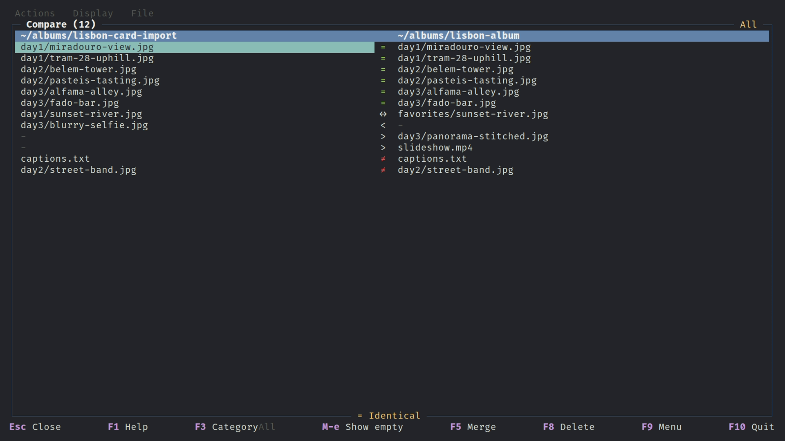

# Compare directories

Compare shows how two directory trees differ: files that exist on only one side, identical files, files that moved to a different path, and files with different content. Files at the same path are compared chunk by chunk and the comparison stops at the first difference; files without a partner are hashed with SHA-256, so renamed or relocated copies are recognised. Local directories only.

## Open

`Ctrl+Alt+C` (`panel.compare-panels`, leader `C`, Command menu, Compare panels) compares the left panel's directory with the right panel's. The directories must not contain one another. It is also reachable from [Find duplicates](find-duplicates.md) (`Ctrl+Alt+C`), where it compares the selected file's directory with the directory under the Copies cursor and returns to the duplicates view on `Esc`. Keys are rebindable in `keybindings.toml` (`[compare]` for the keys below).

## Results

Two columns, one per side, list the path of each file (only the differing part when both roots share a prefix). A status icon and the bottom-border legend say what the row is:

| Class | Meaning |
|---|---|
| Identical | same path and content |
| Relocated | same content, different path |
| Only on one side | exists in one tree only |
| Content differs | same path, different content |

Files are compared in parallel (`hash_concurrency`); rows show Pending or Hashing until settled. Same-path files of different size are marked as different without being read. Same-path files of equal size are read `chunk_bytes` at a time (32 MiB by default) and stop at the first differing chunk, the same check the [conflict rules](jobs.md#verify-both-to-see-if-identical) use. The Hashed count in the border counts both files of a pair. Zero-byte files are hidden by default (`N empty hidden` in the border).

## Keys

| Key | Action |
|---|---|
| `Left` / `Right`, `Tab` | choose the focused column |
| `Up` / `Down`, `PgUp` / `PgDn` | move through rows |
| `Enter` | go to the file in the browser and close |
| `F3` | `compare.cycle-filter`: Category dialog, show any mix of the classes |
| `Shift+F3` | `compare.reset-filter` |
| `Alt+F` | `compare.filter-dialog`: filter by name, see [Panel filter](panel-filter.md#compare-view) |
| `Alt+E` | `compare.toggle-empty` |
| `Alt+R` | `compare.refresh`: rescan, keeping cursor and filters |
| `F5` | `compare.merge`: merge dialog: choose the destination side and optionally delete duplicates; runs as jobs |
| `F8` | delete the focused column's file(s) |
| `Esc` | `compare.close` |

## Selecting in results

Selection acts on the focused column's panel: `Insert` / `Space` toggle the row's path, `Alt+K` selects a range, `*` inverts, `Ctrl+U` clears. `+` and `-` open the category dialog in select or unselect mode, choosing every visible row of the ticked classes (including one-sided classes). Selections persist in the panels after leaving the view and feed copy, move and delete as usual ([Selections](selections.md)). Deleted files drop out of the results without a rescan.

## Options

`[compare]` in [config.md](config.md#compare): `hash_concurrency`, `read_buffer_kib`, `chunk_bytes`, `stay_on_volume_default`.
