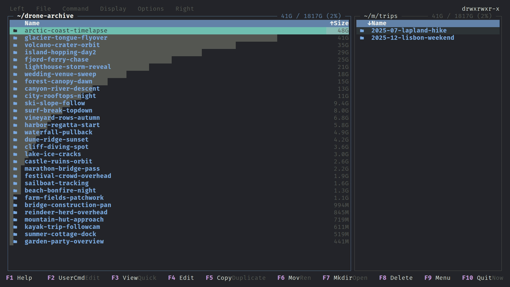

# Disk usage

Disk usage scans directory sizes in the background and draws a proportional bar behind each row, so you can see where the space goes. It is not available on SFTP panels.

## Open

| Key | Action |
|---|---|
| `Alt+D` | `panel.disk-usage-scan`: scan the active panel's directory (leader `D`, Left/Right menu, Disk usage) |
| `Alt+Space` | `panel.dir-size`: size only the directory under the cursor, then move down |
| `Ctrl+Alt+D` | `panel.disk-usage-clear`: abort the scan and drop all the data |

Both are rebindable in `keybindings.toml`.

## Behaviour

A scan walks the listed directory and each directory directly in it. While it runs, the menu bar spinner is active, rows show a working icon, and the bars grow. Sizes are shown in the size column and as a bar relative to the largest entry. When the scan finishes a toast reports it.

The scan scope is global: bars appear on whichever panel is inside the scanned directory or one of its children, and disappear when you navigate elsewhere (they return when you come back). `Alt+Ctrl+D` clears the data, the bars and any size-based ordering on both panels.

Size-based ordering: with `idle_size_sort` on (default), a panel sorted by size is re-sorted once the cursor has been idle for `idle_sort_delay_ms`, instead of jumping on every update. Sort by size from the [Sort dialog](panels.md#sorting).

Other places use the same cache: selected directories show their total in the [selection size](selections.md#selected-strip), expanded [tree](panels.md#tree-view) directories are sized, and the delete and copy dialogs scan their sources. Scanned folders follow every change paras-commander makes, without a rescan. Renaming or moving an entry carries its cached size along. Deleting drops it, so a new entry with the same name starts unsized. Copying, moving, extracting, creating directories or links, and undoing any of these grow or shrink the scanned folders above them by exactly what changed, and an overwrite counts only the difference. When the change can't be measured (an archive tool's output, a delete or copy that stopped part way), the affected entry is shown as pending and rescanned on its own, and its parents' totals are corrected when that finishes. Changes made outside paras-commander still need a rescan.

Directories listed in `~/.goduignore` and mount points are skipped and shown dimmed with a special folder icon. Scans do not cross into other mounted filesystems unless `descend_into_mount_points` is on. The panel also shows the volume's free and total space on its top row.

While a copy or move job is using the same volume, automatic scans and refreshes pause; explicit scans (`Alt+D`, delete summary) always run. See [Background scan throttle](background-scan-throttle.md).

## Options

- `[disk_usage]`: `idle_size_sort`, `idle_sort_delay_ms`, `descend_into_mount_points` ([config.md](config.md#disk_usage)).
- `[fs_walk]`: `initial_workers`, `max_workers`, `adapt_interval_ms`. A walk starts with `initial_workers` concurrent directory branches (default 1), raises concurrency while throughput improves and freezes at the best limit ([config.md](config.md#fs_walk)).
