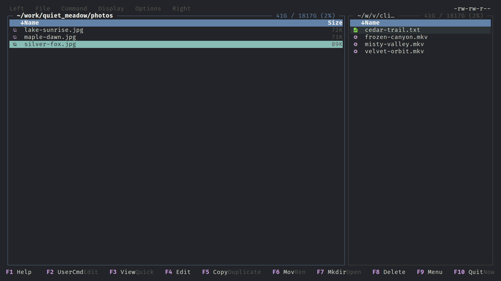

# Paras Commander

A Linux terminal twin-panel file manager inspired by Midnight Commander and
fzf, written in Go using a TUI.

New here? Start with [Getting started](getting-started.md), then
[Shortcuts](shortcuts.md) and [Config](config.md).

## Features

- **fzf-style everywhere** — type to fuzzy-match file lists, dialogs and keybinding help. See [Panels](panels.md), [Panel filter](panel-filter.md).
- **Background job queue** — copy, move and delete run queued in the background with progress, transfer graphs, rate limits and retry. See [Jobs](jobs.md), [File operations](fileoperations.md).
- **Git aware** — gitignore filtering and eza-style git status column, stage/unstage, diff preview. See [Panels](panels.md).
- **Previews** — quick view, fullscreen preview, carousel, syntax highlighting, markdown, images, archives. See [Quick view and preview](quick-view-preview.md), [Graphics](graphics.md), [Archives](archives.md).
- **Selections** — across multiple paths, group select, stash and restore. See [Selections](selections.md).
- **Navigation** — history, pins, bookmarks (`~/.fzf-marks`, GTK), panel sync, jump to directory, recursive find over millions of files. See [Navigation](navigation.md), [Find files](find-files.md).
- **Tools** — [disk usage](disk-usage.md), [directory compare](compare-directories.md), [find duplicates](find-duplicates.md), [mass rename](mass-rename.md).
- **Commands** — run a command for each selected file, user menu with background and worker-pool commands, [meta columns](meta-columns.md) fed by external commands. See [Commands](commands.md).
- **Remote** — browse SFTP hosts from `~/.ssh/config`. See [SFTP](sftp.md).
- **Subshell** — `Ctrl+O` shell with selected filenames at hand. See [Subshell](subshell.md).
- **Editor integration** — file chooser mode for Helix and others. See [Chooser mode](chooser-mode.md).
- **Configurable** — [config](config.md), [keybindings](keybindings.md), [themes](themes.md).
