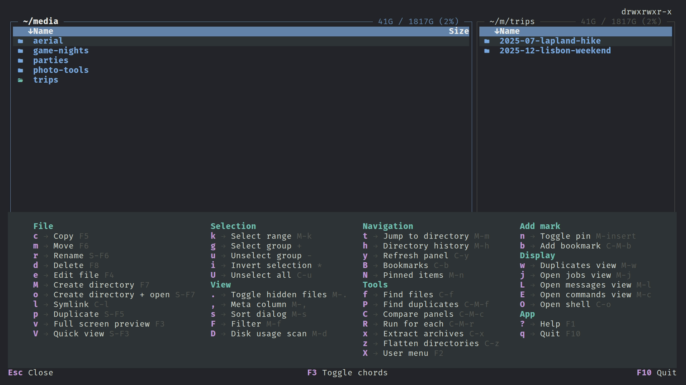

# Menus

Three ways to reach commands besides direct shortcuts: the menu bar, the leader (function) menu, and the user menu.

## Menu bar

Press `F9` to focus the bar. Enter or Down opens a pulldown, each row has a mnemonic letter that runs it, and `Esc` steps back (pulldown, bar, normal). On the focused bar, a plain letter opens that top-level menu; `Alt+letter` opens it from anywhere. Display's letter `d` works only on the bar, since `M-d` belongs to disk usage. Rows show the current key binding for each action, resolved from your `keybindings.toml`.

Browser pulldowns: Left, File, Command, Display, Options, Right. Left and Right hold the per-panel commands (sort, hidden files, history, find, jump, columns, carousel, tree, SFTP) for the panel at that screen position. File has copy, move, rename, delete, mkdir, links, chmod/chown, extract, rsync, flatten, unflatten and selection commands. Command has user menu, run for each, split/swap, compare panels, find duplicates and bookmarks. Display switches to Commands, Messages, Duplicates, Jobs and the shell, and opens Status commands (which [status commands](status-commands.md) the menu bar shows). Options has Configuration, Preview settings, Calibrate Debounce, Theme and Reload configuration (re-reads `config.toml`, `keybindings.toml` and the themes; see [config.toml reference](config.md#reloading-while-running)).

Hide the bar with `show_menu_bar = false` ([Layout](layout.md#menu-bar)). The fullscreen preview has no bar.

## Leader (function) menu

Press `:` (press again to close) for a grouped, multi-column strip docked at the bottom: File, Selection, View, Navigation, Tools, Add mark, Display, App. A single row of menu entries (user menu, copy-to-clipboard menu, git menu, fileindex menu) sits at the bottom with a blank row above it, one entry per column and without a heading, each marked with an open-in-new icon (with Nerd Font icons); it is the first thing dropped when the terminal is too short. Press the letter shown next to an entry to run it.

- Letters come from `[leader_key]` in `keybindings.toml`; set one to `""` to drop the row. Keys must be unique within each menu; upper and lower case are distinct. Letters can differ between menus.
- `F3` toggles showing each action's direct key after its name (`[ui] leader_menu_show_direct_keys`).
- `Esc` closes the strip.
- `"` (also `"` in the `:` menu's bottom row) opens the copy-to-clipboard menu (`[copy_menu]`) with file URL, directory URL, file name and git-relative paths (each target is made relative to the work tree that holds it; targets outside any repository are skipped, and the submenu is dimmed when none is in one). It also copies the contents of the text file in the fullscreen preview or under the file list cursor (the row is dimmed on directories, images, audio/video, archives and remote files; binary and oversized files are refused when you activate it). In the fullscreen preview, `:` opens a preview menu (`[preview_menu]`) instead.
- `<` (also `<` in the `:` menu's bottom row) opens the [fileindex](fileindex.md) menu (`[fileindex_menu]`). Its letters are the actions' own shortcut letters in lowercase; those shortcuts are all `Alt+Shift` plus the letter (`t` for `M-T`).
- `M-g` (also `G` in the `:` menu's bottom row) opens the git menu: filter by git state (staged, unstaged, tracked, untracked), commit / pull / push, and stage / unstage / untrack the selection or cursor entry.
- `M-C` opens a menu to set or clear the folder color (see `folder-colors.md`).

## Vi-motion mode

`Esc` in the browser toggles a persistent mode, shown by a yellow border. Plain `h`/`j`/`k`/`l` act as arrow keys and the leader letters fire their action directly, with the footer showing them. Press `Esc` again to leave. The mode carries over into the Jobs, Commands, Messages, Compare and Duplicates views. In Commands bare `k` moves the cursor, so reach Kill via `:`, `F9` or `S-F8`.

## Per-view menus

The Jobs, Commands, Messages, Compare and Duplicates views each have their own `:` menu and F9 bar scoped to that view's actions, plus shared App (quit, help) and Display (jump to another view) groups. A selection action keeps the same letter everywhere (range `k`, select group `g`, unselect group `n`, unselect all `u`, invert `I`). Close is `x` and Clear is `c` where they exist.

## User menu

`F2` (or `§` or `;`) opens your own command list from `menu.toml`, with submenus, optional hotkeys and conditions. `F4` inside it edits the file and reloads. When `menu.toml` has an error (or no entries to show), the menu still opens showing the full error in place of the entries, so `F4` can fix the file. Entries and fields are described in [Commands](commands.md) and [`[user_menu]`](config.md#user_menu).
