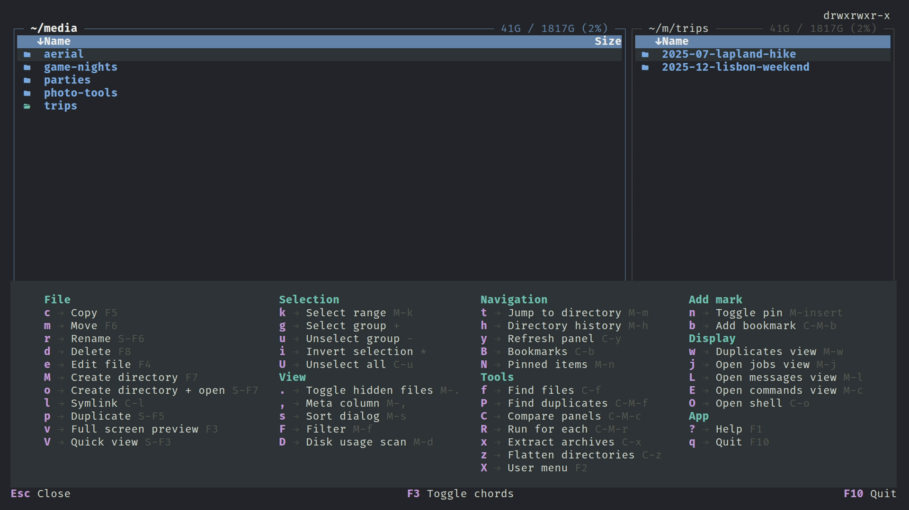

# Menus

Three ways to reach commands besides direct shortcuts: the menu bar, the leader (function) menu, and the user menu.

## Menu bar

Press `F9` (`app.open-menu`) to focus the bar. Enter or Down opens a pulldown, each row has a mnemonic letter that runs it, and `Esc` steps back (pulldown, bar, normal). On the focused bar, a plain letter opens that top-level menu; `Alt+letter` opens it from anywhere. Display's letter `d` works only on the bar, since `Alt+D` belongs to disk usage. Rows show the current key binding for each action, resolved from your `keybindings.toml`.

Browser pulldowns: Left, File, Command, Display, Options, Right. Left and Right hold the per-panel commands (sort, hidden files, history, find, jump, listing format, carousel, tree, SFTP) for the panel at that screen position. File has copy, move, rename, delete, mkdir, links, chmod/chown, extract, flatten and selection commands. Command has user menu, run for each, split/swap, compare panels, find duplicates and bookmarks. Display switches to Commands, Messages, Duplicates, Jobs and the shell, and opens Status commands (which [status commands](status-commands.md) the menu bar shows). Options has Configuration, Preview settings, Calibrate Debounce and Theme.

Hide the bar with `show_menu_bar = false` ([Layout](layout.md#menu-bar)). The fullscreen preview has no bar.

## Leader (function) menu

Press `:` (`app.leader-menu`; press again to close) for a grouped, multi-column strip docked at the bottom: File, Selection, View, Navigation, Tools, Add mark, Display, App. Press the letter shown next to an entry to run it.

- Letters come from `[leader_key]` in `keybindings.toml`; set one to `""` to drop the row. Keys must be unique within each menu; upper and lower case are distinct. Letters can differ between menus.
- `F3` toggles showing each action's direct key after its name (`[ui] leader_menu_show_direct_keys`).
- `Esc` closes the strip.
- `"` (`app.copy-menu`) opens the copy-to-clipboard menu (`[copy_menu]`) with file URL, directory URL, file name and git-relative paths. In the fullscreen preview, `:` opens a preview menu (`[preview_menu]`) instead.
- `Alt+G` (`panel.git-filter-menu`) opens a small menu to filter by git state (staged, unstaged, tracked, untracked).

## Vi-motion mode

`Esc` in the browser (`panel.vi-motion-toggle`) toggles a persistent mode, shown by a yellow border. Plain `h`/`j`/`k`/`l` act as arrow keys and the leader letters fire their action directly, with the footer showing them. Press `Esc` again to leave. The mode carries over into the Jobs, Commands, Messages, Compare and Duplicates views. In Commands bare `k` moves the cursor, so reach Kill via `:`, `F9` or `Shift+F8`.

## Per-view menus

The Jobs, Commands, Messages, Compare and Duplicates views each have their own `:` menu and F9 bar scoped to that view's actions, plus shared App (quit, help) and Display (jump to another view) groups. A selection action keeps the same letter everywhere (range `k`, select group `g`, unselect group `n`, unselect all `u`, invert `I`). Close is `x` and Clear is `c` where they exist.

## User menu

`F2` (or `<`; `app.user-menu`) opens your own command list from `menu.toml`, with submenus, optional hotkeys and conditions. `F9` inside it edits the file and reloads. Entries and fields are described in [Commands](commands.md) and [`[user_menu]`](config.md#user_menu).
