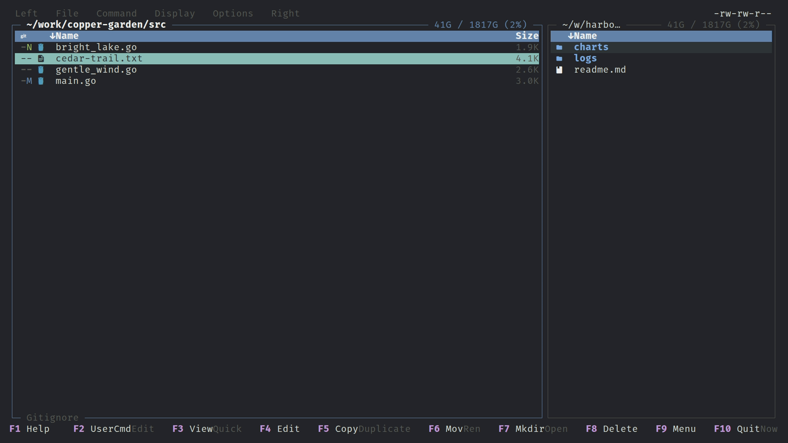

# Panels

Each panel lists one directory. This page covers what a listing shows, how to change its layout, sort and hidden-file behaviour, and the git integration. Selecting files is in [Selections](selections.md), computed columns in [Meta columns](meta-columns.md), sizes in [Disk usage](disk-usage.md), and moving between directories in [Navigation](navigation.md).



Directories load in the background. A slow directory (network mount, SFTP) keeps showing the old listing and the target row gets a working icon until the new one arrives.

## Listing formats and columns

Press `Alt+T` (`panel.cycle-listing-format`) to cycle the active panel through the three layouts, or use Left/Right menu, Listing format (`panel.listing-format-dialog`).

| Format | Columns |
|---|---|
| `brief` | name, meta columns, size |
| `mtime` | name, meta columns, size, modified time |
| `perm` | as `mtime` plus permissions |

`default_listing_format` in [config.md](config.md#panels) picks the startup format. A narrow panel can show only the name column (`[ui].shrunken_shows_name_only`, see [config.md](config.md#ui)). `Alt+Z` (`panel.toggle-zoom-active-panel`) zooms the active panel for the session, and `Shift+Tab` (`panel.toggle-hide-inactive`) hides the inactive one. See [Layout](layout.md).

### Long names

A name too long for its column is shortened word by word (words are split at `.`, `-`, `_` and spaces) rather than cut in the middle:

1. The longest words are abbreviated first, down to five letters (`Lantern` → `Lant` happens only later; a word loses at least three letters at once so it never looks like a typo).
2. Words in the middle are then dropped as one gap shown as `…`, growing outward from the centre. The first and last words stay.
3. The remaining words are abbreviated further, down to four letters, then the last word is dropped and the first word shortened.

A short file extension (up to five letters, such as `.odt`) is always kept, and words containing digits (`2019`, `v3`, `0042`) are never abbreviated, only dropped whole. Each step only removes text, so dragging a panel narrower never brings back a part that a wider panel had hidden.

The letter where a word was abbreviated, and the `…`, are drawn in the row colour's counterpart shade (blue ↔ bright blue, white ↔ bright white; bold blue, which most terminals already draw bright, marks with plain blue; other colours are lightened or darkened), so the cut is visible without spending a character:

```
Garden.Lantern.Whisper.2019.Pebble.Draft.odt
Garden.Lantern.Whisper…Pebble.Draft.odt
Garden.Lantern…Draft.odt
Garden…Draft.odt
Garden….odt
```

## Sorting

`Alt+S` (`panel.sort-dialog`, leader `s`, Left/Right menu, Sort...) opens the Sort dialog for the active panel: sort key (Name, Extension, Size, Modified, and any active [meta column](meta-columns.md)), reverse, directories first, and optional size ordering while a [disk usage](disk-usage.md) scan runs. The header arrow shows the sorted column and points toward larger values. `default_sort`, `sort_reverse` and `directories_first` set the startup behaviour. `panel.cycle-sort` and `panel.reverse-sort` are unbound by default and can be bound in `keybindings.toml`.

## Hidden and ignored files

`Alt+.` (`panel.toggle-hidden`, leader `.`, Left/Right menu, Toggle hidden) shows or hides dotfiles together with files ignored by git. The setting is global for both panels. With `respect_gitignore` on (default) and hidden files off, entries matched by `.gitignore` and `.git/info/exclude` are hidden inside a git work tree; outside one only dotfiles are affected. Copy, move, delete and scans always see the real filesystem. A "Gitignore" indicator on the panel's bottom border shows when ignore filtering is active.

## Tree view

Left/Right menu, Tree view (`panel.toggle-tree`, unbound by default) turns the panel into an expandable tree; a ` Tree ` chip appears on the border. Directories load lazily as they expand. Tree view and the carousel view (`Alt+V`) are mutually exclusive.

| Key | Action |
|---|---|
| `Alt+Right` / `Alt+Left` | `panel.tree-expand` / `panel.tree-collapse`. Pressing expand again on an open directory opens one more level below it. Collapse on a file or closed row jumps to the parent. |
| `Ctrl+Alt+Right` / `Alt+Shift+Right` | Expand all, one level per press / fully |
| `Ctrl+Alt+Left` / `Alt+Shift+Left` | Collapse all, one level per press / fully |
| `Alt+Up` / `Alt+Down` | Previous / next sibling directory |

Expand-all is capped (a depth limit for the shallow variant and a total row limit) and shows a `Depth: N/5` toast. The expanded set and cursor are remembered per directory for the session. Enter and Right still change into a directory.

## Git

Inside a local git work tree a two-cell status column appears before the name (not on SFTP panels or in name-only layout). Letters follow `eza`: staged in the first cell, unstaged in the second.

| Letter | Meaning |
|---|---|
| `N` | new / untracked |
| `M` | modified |
| `D` | deleted |
| `R` | renamed |
| `T` | type change |
| `I` | ignored |
| `U` | conflicted |
| `-` | unchanged (also shown while the status loads) |

Directories show a summary of their contents. Status is read in the background with `git status`.

- `Alt++` (`git.stage`) and `Alt+-` (`git.unstage`) stage or unstage the selected entries, or the cursor entry (then moving the cursor to the next entry).
- `Alt+G` (`panel.git-filter-menu`) opens a menu that limits the panel to Staged, Unstaged, Tracked or Untracked entries. The filter is dropped when you leave the repository. Its **Commit** row runs `git commit` in your editor (the TUI is suspended meanwhile) when something is staged. **Push** (`P`) and **Pull** (`p`), matching lazygit, run `git push` / `git pull` in the background; credentials must come from an SSH agent or credential helper, since there is no terminal to prompt in.
- Viewing (`F3`) or quick-viewing a modified file shows its diff; see [Quick view and preview](quick-view-preview.md). `Ctrl+Alt+J` / `Ctrl+Alt+K` jump between changes (`preview.diff-next-hunk` / `preview.diff-prev-hunk`).

## Row indicators

Symbols at the end of a name:

- A new-file mark on entries created by the last copy, move or flatten into this directory; the previous batch is shown in a second color and all earlier ones are dimmed. The marks clear when you leave the directory or refresh the panel.
- An open-folder symbol on a directory the other panel currently shows.
- A name-match mark on rows whose name also exists in the other panel's directory (`other_panel_match_marks` in [config.md](config.md#ui)); the name under the cursor is highlighted in both panels.
- Job, queued, pinned and no-permission marks; see [Jobs](jobs.md).

After a copy or move into the other panel's directory, that panel's cursor jumps to the first transferred entry unless you already moved it (`focus_other_panel_after_transfer`, [config.md](config.md#operations)).

## Opening files

- `Enter` / `Right` (`nav.open`) enters a directory. On a local executable (`+x` with a shebang or ELF header) it runs the file when `run_executables_on_enter` is on; the output appears in the Commands view, or in the background for rules in `panels.execute_rules` (AppImages by default). Other files open with the desktop default application when `open_files_externally` is on; when `xdg-open` is not installed they open in the full-screen preview.
- `F4` (`file.edit`, also `Alt+E`) edits the file in `$EDITOR`.
- `F3` (`file.view`) opens the file preview.

## Staying current

Panels re-read their directory every `refresh_interval_ms` (default 2500, `0` disables). Changes are applied without losing the cursor, selection or scroll position. A slow directory is polled less often. `Ctrl+Y` (`panel.refresh`) forces a full reload and also recalculates [meta columns](meta-columns.md).

Each panel remembers the focused entry per directory, so going back (see [Navigation](navigation.md)) lands on the item you left.

`Alt+Y` (`panel.toggle-sync`) latches the active panel as driver: moving the cursor onto a directory shows it in the other panel. `Alt+O` / `Alt+I` open the cursor directory or the current path in the other panel.
