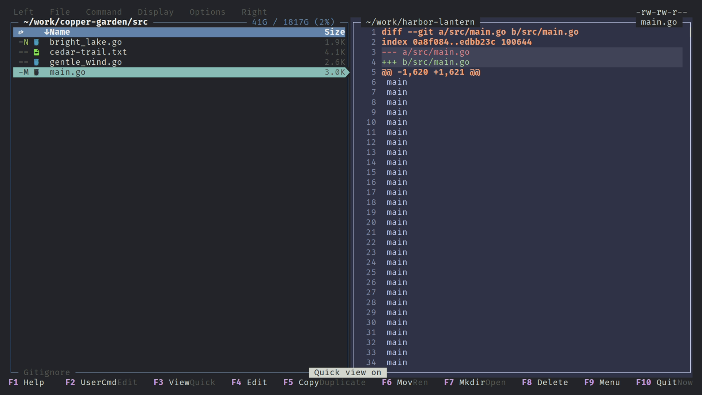

# Quick view and file preview

Paras Commander previews files in three places: **quick view** (the inactive panel follows the cursor), the **fullscreen preview** (F3) and the **carousel** view (parent | current | child columns). All three share the same renderer: syntax highlighting, rendered Markdown, images, video thumbnails, directory listings, archive contents and git diffs.



## Opening

| Surface | Default key | Action id | Menu / leader |
|---|---|---|---|
| Fullscreen preview | `F3` (also `Ctrl+V`) | `file.view` | Esc, `v` |
| Quick view | `Shift+F3` (also `Ctrl+Alt+V`) | `file.quick-view` | Left/Right -> Quick view; Esc, `V` |
| Carousel view | `Alt+V` | `panel.toggle-carousel` | Left/Right -> Carousel view |
| Preview settings | `Alt+F3` | `preview.settings-dialog` | Options -> Preview settings |

All keys are rebindable in `keybindings.toml`. From the command line, `pc -qp <path>` starts with quick view on, `pc <file>` opens the file in the fullscreen viewer (where `q` quits the app) and `pc --carousel` starts in carousel view.

## Quick view

Quick view is per panel: the panel you turn it on for becomes the driver, and the other panel shows a preview of whatever the driver's cursor is on. The driver's bottom border shows ` Quick view -> ` and an arrow glyph on the cursor row points at the preview. The inactive panel keeps its own path, cursor and selection and returns when quick view is switched off.

- A directory under the cursor is listed in the preview pane (the directory is not entered and history is not touched).
- `Ctrl+K` / `Ctrl+J` (`file.quick-view.preview-page-up` / `-down`) page the preview without leaving the file list.
- `Tab` only swaps the active panel while quick view is on. With it off, `Tab` cycles file list, selected strip and the preview pane, so arrows scroll the preview when it has focus.
- Quick view and [panel sync](navigation.md#latched-panel-sync) are mutually exclusive; turning one on turns the other off. Zoom is disabled while a preview is shown (even 50/50 split).
- With `[preview].quick_view_disable_on_inactive_nav` (default on) quick view switches off when the inactive panel navigates elsewhere, for example through "open in other panel".
- Empty files are skipped by quick view; F3 still opens them.

## Fullscreen preview (F3)

The preview takes the whole screen (no menu bar; the filename is the top row). Besides the vim-style keys below, arrows, PgUp/PgDn, Home, End and Space scroll as usual.

| Key | Action id | Does |
|---|---|---|
| `j` / `k` | `preview.scroll-down` / `-up` | Scroll a line |
| `Ctrl+D` / `Ctrl+U` | `preview.half-page-down` / `-up` | Half page |
| `Ctrl+F` / `Ctrl+B` | `preview.page-down` / `-up` | Full page |
| `g` / `G` | `preview.top` / `preview.bottom` | Start / end |
| `/` | `preview.search-start` | Search (case-insensitive, literal); Enter accepts, Esc cancels |
| `n` / `p` | `preview.search-next` / `-prev` | Next / previous match (wraps) |
| `F5` | `preview.reload` | Re-read the file from disk, keeping scroll and search |
| `F6` | `preview.toggle-raw` | Markdown: switch between rendered and raw source |
| `F9` | `preview.theme-picker` | Pick the syntax theme (live preview, Enter saves, Esc reverts) |
| `:` | `preview.menu` | Preview menu |
| `Ctrl+Alt+J` / `Ctrl+Alt+K` | `preview.diff-next-hunk` / `-prev-hunk` | Next / previous change in a diff (also in quick view) |
| `Esc`, `q`, `h` | `preview.close` | Close (`q` quits when pc was started with a file argument) |

The preview menu (`:`) lists theme picker, raw toggle, reload, search, next/previous diff change, Edit, Delete and Quit, each on a letter key; the letters are configurable in the `[preview_menu]` section of `keybindings.toml`. F4 edits the file and returns to the preview. Image previews ignore `/` search and the F9 picker.

The scrollbar on the right shows where you are in long content.

## What gets previewed

- **Text and source**: highlighted with Chroma. `[preview].style` selects the theme (default `catppuccin-frappe`); `[preview].line_numbers` toggles the gutter. Add your own Chroma XML styles to `~/.config/pc/themes/preview/*.xml` (they appear in the F9 picker; a custom style with a built-in's name overrides it, and the name `default` is reserved). Preview themes are separate from UI [themes](themes.md).
- **Markdown**: rendered with headings, emphasis, lists, quotes, links, tables and highlighted code fences. `F6` shows the source. In external mode point `[preview].command` at `glow` instead.
- **Git diff**: a file with uncommitted changes shows its diff (staged-only changes diff against the index, others against HEAD) with the whole file visible. Unmodified, new or ignored files show plain content; the fullscreen title then reads `<filename> (<status>)`.
- **Images**: drawn through Sixel, Kitty or Ueberzug++; see [Terminal graphics](graphics.md) for protocols, tmux and troubleshooting. A caption under the image carries format, size and EXIF metadata at the level set by `[preview].image_metadata` (`off`, `basic`, `essentials`, `full`). EXIF orientation is applied to the picture. Formats the Go library cannot decode (such as `.psd`) go through ImageMagick if `magick` or `convert` is installed.
- **Video and audio**: ffprobe metadata, and for video a thumbnail grid made with ffmpeg (`video_thumb_cols`, `video_thumb_rows`, `video_metadata`). Thumbnails are cached under `$XDG_CACHE_HOME/pc/video-thumbs/`.
- **Directories**: listed in quick view and the carousel child column; F3 on a directory only works when an external rule handles it.
- **Archives**: shown as a tree, see [Archives](archives.md).
- **Binary files** (a NUL byte in the first bytes) show a one-line message instead of garbage.

Non-UTF-8 text is read as Windows-1252.

## External preview commands

`[[preview.commands]]` rules run an external program for matching files or directories, in quick view, F3 and the carousel child column. Rules use the same predicate language as the meta columns ([Predicates](predicates.md)) and are tried top to bottom; exit code 0 means the command's output is the preview, non-zero passes to the next rule and finally the built-in preview.

```toml
[[preview.commands]]
when = ["t d"]
command = "eza --tree --level=2 %f"
```

If the output begins with a Sixel or Kitty graphics sequence it is shown as an image, so tools such as `chafa` work. On Linux the command runs on a pseudo-terminal that answers terminal capability queries, so tools that probe for Sixel support fall back to text less often. `%f` is the file, `%w` the pane width. Setting `[preview].mode = "external"` replaces the built-in highlighter with `[preview].command` (default `bat`).

## Carousel view

Carousel shows three columns for the active panel: the parent directory, the current directory and a child column that previews the item under the cursor (directory listing or file preview). Navigation, filter and group select act on the centre column; the side columns are read-only. The inactive panel is hidden while the carousel is active (`[carousel].autohide_inactive_panel`). `Ctrl+K` / `Ctrl+J` page a long child preview. Column widths and size columns are set in `[carousel]`. Listing format and tree view are not available in carousel mode.

## Preview settings dialog

`Alt+F3` (Options -> Preview settings) records what the terminal supports (Sixel, Kitty, Kitty Unicode placeholders), the image protocol, the image metadata level and the video metadata line. `F5` auto-detects capabilities. OK writes the `[preview]` keys.

## Options

All keys are in [Config: `[preview]`](config.md#preview): `mode`, `style`, `line_numbers`, `command`, `commands`, `shell_patterns`, `images`, `image_protocol`, `image_metadata`, the video thumbnail keys and the prefetch keys. Prefetching decodes nearby images in the background while quick view or carousel is active. Key-repeat and media debounce are under [`[ui]`](config.md#ui) and can be calibrated at Options -> Calibrate Debounce.
